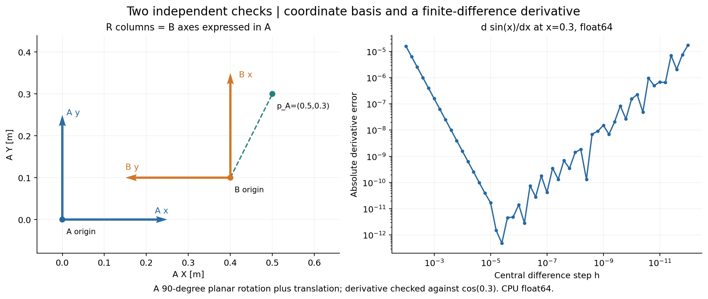
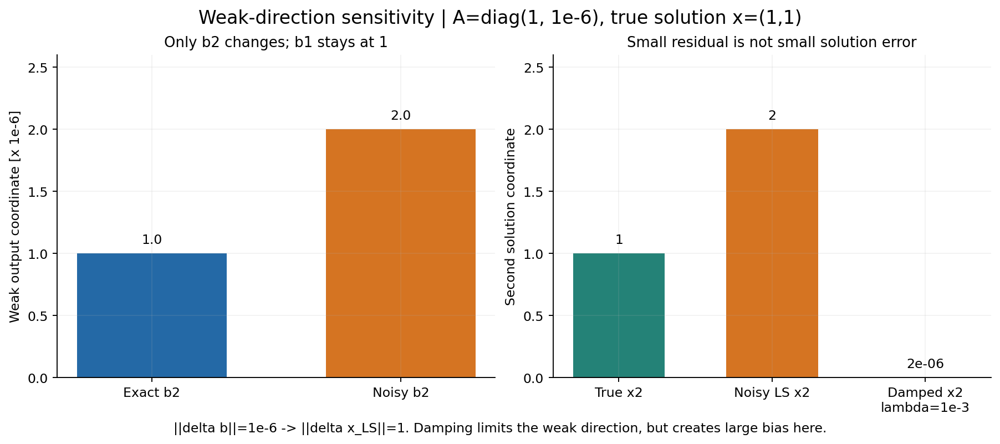
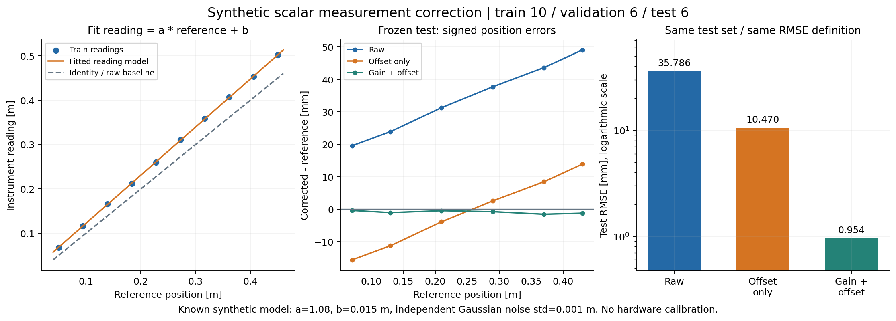

# 第零章图示：把抽象量变成可检查的例子

[学习指南](../学习指南.md) · [核对记录](../示例核对记录.md) · [原始数值](../数据/示例核对数值.json) · [合成CSV](../数据/一维测量示例.csv)

版本：2026-10-30。三幅图均由本次数值计算生成，CPU/float64。图中英文标轴，中文解释如下；参考图不代表个人学习已验收。

## 坐标基与有限差分

左图：蓝色为A坐标轴，橙色为B轴在A中的方向；B原点在A中为[.4,.1] m。p_B=[.2,-.1] m在A中变成[.5,.3] m。先沿B的两根轴组合位移，再加原点位置；点/向量区别见MATH-01。

右图：sin(x)在x=.3的中心差分导数与cos(.3)的绝对误差，h从1e-2逐渐减到1e-12。较小步长先减少截断误差，过小时舍入/相减误差会显现；横轴向右为更小h。显示下限设1e-18，避免对数轴无法表示精确零。

## 弱方向、噪声与阻尼偏差

A=diag(1,1e-6)，真实解[1,1]。左图只画较弱的第二个输出坐标，单位按1e-6缩放；整个b的扰动范数只有1e-6。右图比较真实x2=1、含噪最小二乘x2=2，以及lambda=.001时的阻尼x2≈2e-6。

无阻尼可以精确拟合含噪b，解却错了；阻尼把弱方向压小，仍与真实1有明显距离。它说明稳定性、拟合残差和真实误差需要分别检查，不是“一加阻尼就正确”。

## 合成测量校正与独立验证

左图：10个train参考/读数，拟合r=a*x+b；虚线是直接把读数当位置的基线。中图：6个固定test点的校正误差，单位mm；右图：同一test、同一RMSE定义，对数纵轴。

仅偏置校正移除了平均偏移，却仍留有比例误差；完整校正在本组合成数据上test RMSE≈0.954 mm。val用于预先选择方案，test只作冻结后的比较报告。噪声std=.001 m，参考值准确，均为教学设定，不能据图推出现实相机/机器人精度。
