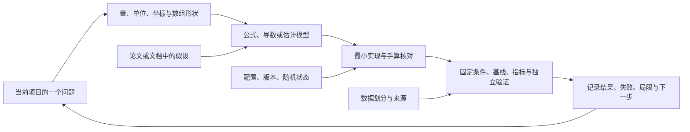

# 第零章怎么用：把基础接到正在做的问题上

[本章概览](README.md) · [知识索引](知识索引.md) · [练习与复盘](练习与复盘记录.md) · [总知识网络](../总知识网络.md) · [第一阶段](../阶段计划/第一阶段_学习范围与周计划.md) · [第二阶段](../阶段计划/第二阶段_学习范围与周计划.md)

版本：2026-10-30。9 节讲义、36 道自编练习、独立答案与参考图。数学和实验方法随主项目使用，计入原每周 10—12 小时，不另开一门必须先学完的课。

## 这章解决什么

基础在这里体现为三个动作：把问题写成明确的量，用一个小例子检查，再说明结果支持什么结论。先能解释变量、单位、依赖和证据，后续公式才容易接到代码中。



学完一小节的标准是：合上资料，解释一个例子；改变一个输入，先预测再验证；保存自己得到的证据。看懂答案可以作为中间状态，独立验收另记。

## 九节导航

| 讲义 | 要回答的问题 | 现在学到哪里 | 答案 |
|---|---|---|---|
| [MATH-01 矩阵、坐标基与形状](讲义/MATH-01_矩阵坐标基与形状.md) | 为什么按这个方向乘，数组每列是什么 | 必须会形状、基向量、点/向量区别 | [答案](参考答案/MATH-01_参考答案.md) |
| [MATH-02 导数、梯度与链式法则](讲义/MATH-02_导数梯度与链式法则.md) | 小输入变化怎样传到输出和损失 | 必须会一阶导与有限差分 | [答案](参考答案/MATH-02_参考答案.md) |
| [MATH-03 概率、统计与不确定性](讲义/MATH-03_概率统计与不确定性.md) | 一次结果与多次结果怎样解释 | 先会均值/方差、分母、条件概率 | [答案](参考答案/MATH-03_参考答案.md) |
| [MATH-04 最小二乘、伪逆与数值误差](讲义/MATH-04_最小二乘伪逆与数值误差.md) | 为什么有解但结果很不稳定 | 必须会最小二乘；SVD/条件数先理解作用 | [答案](参考答案/MATH-04_参考答案.md) |
| [EXP-01 数据划分与泄漏](讲义/EXP-01_数据划分与泄漏.md) | 验证到底测了哪种泛化 | 第二阶段开始完整使用 | [答案](参考答案/EXP-01_参考答案.md) |
| [EXP-02 指标、基线与消融](讲义/EXP-02_指标基线与消融.md) | 怎样比较一个改动 | 从第一个误差实验开始用 | [答案](参考答案/EXP-02_参考答案.md) |
| [EXP-03 配置、种子与复现](讲义/EXP-03_配置种子与复现.md) | 为什么重跑不同，怎样查 | 从 W01 留配置与实际输入 | [答案](参考答案/EXP-03_参考答案.md) |
| [EXP-04 论文阅读与复现边界](讲义/EXP-04_论文阅读与复现边界.md) | 新方法解决什么、证据在哪 | 任务相关时读一篇，不以数量打卡 | [答案](参考答案/EXP-04_参考答案.md) |
| [EXP-05 中断恢复与项目证据](讲义/EXP-05_中断恢复与项目证据.md) | 忙一周后如何接着做 | 从当前任务开始使用恢复记录 | [答案](参考答案/EXP-05_参考答案.md) |

本期不要求概率推断、流形优化、系统辨识或严格统计推断。证明细节和更多数学工具在研究问题需要时补。

## 怎样接回已有章节

| 当前任务 | 在第零章补什么 | 回到哪里验证 |
|---|---|---|
| W01 工程与数组 | MATH-01 第1/3题，EXP-03 基本配置 | 第一章已有数据读写与日志 |
| W03—W04 坐标和模型 | MATH-01 点/向量与逆变换 | 第三章 KIN-01/02，第二章 TF2 |
| W06 雅可比与 IK | MATH-02 有限差分，MATH-04 病态/阻尼 | 第三章 KIN-05/06，复用已有曲线 |
| W08—W13 控制与 P1 | MATH-03 简单误差统计，EXP-02/03/05 | 第四章误差与全部试验，第六章复位 |
| W15—W17 标定 | MATH-04 最小二乘直觉，EXP-01 独立数据 | 第五章内参/手眼留出验证 |
| W20—W21 P2 | EXP-02 指标与失败，EXP-03/05 记录 | 原有固定场景评测 |
| 后续网络、IL、RL | MATH-02/03，EXP-01/04 | 第七章训练与第八章任务闭环 |

表中内容是原任务的配套解释。已经验收过同一知识点，可直接链接自己的结果；不为第零章重复做一份项目。

## 一个可选的贯穿例子：校正一维测量读数

假设参考位置 x 是准确已知的米制量，模拟仪器读数：

$$r=1.08x+0.015+\epsilon,\quad \epsilon\sim N(0,0.001^2)\ \mathrm{m}.$$

用 train 的 x/r 拟合 `r=a*x+b`，校正新读数为 `x_hat=(r-b)/a`。比较原始读数、仅偏置校正、增益+偏置校正。它把最小二乘、噪声、数据划分、指标和实验记录串起来；模型与噪声是教学假设，不是真实相机或机器人标定。

数据见[合成 CSV](数据/一维测量示例.csv)：10 train、6 val、6 test，split 和 case_id 明确。训练参考点是 0.05—0.45 m 的10个等间隔值；val/test 使用独立噪声和指定参考点，采样条件见[核对记录](示例核对记录.md)。小样本仅用于验证流程。

自己完成：读数据、拟合参数、比较基线、画误差、写一页结论。答案只给局部函数/手算。已有 IK 或标定项目时，也可以直接用自己的项目完成同类验收。

拟合的是已知 x 到有噪声读数 r 的关系；若参考 x 也有明显误差，普通最小二乘的假设就需要重新检查。最终 test 只用于冻结方案后的报告，不用来选择偏置/完整模型。

## 每次怎样学

1. 用 5 分钟写下现在的疑问和预测，例如“噪声这么小，为什么求解误差这么大”。
2. 查讲义指定资料的一小段，写清输入输出和假设。
3. 先做一题，留下一个手算、数值或记录文件。
4. 对照提示，修正后解释；最后写下次第一步。

第一次约 45—60 分钟：MATH-01 第1题，EXP-03 的配置字段，EXP-05 的恢复卡。导数、概率和 SVD 随后按任务进入；不先通读数学教材。

## 资料与工具

数学主线用 [MML 免费教材](https://mml-book.github.io/) 第2/3/5/6/9章中的对应主题；机器人坐标查 [Modern Robotics](https://hades.mech.northwestern.edu/index.php/Modern_Robotics) 第3章。NumPy 官方文档用于核对具体函数，选读入口见各节和本章 README。

示例核对使用系统 `/usr/bin/python3`，Python 3.12.3、NumPy 1.26.4、Matplotlib 3.6.3；不安装新依赖。小数组和统计实验用 CPU 即可，本章不以 GPU 或真机为前置。NumPy 版本不同应记录；不要混用解释器和 pip。

```python
import sys
import numpy as np
print(sys.executable, sys.version.split()[0], np.__version__)
```

参考图、实际数值与检查范围见[核对记录](示例核对记录.md)。所有个人练习状态保留未开始；进展写入[复盘表](练习与复盘记录.md)。
