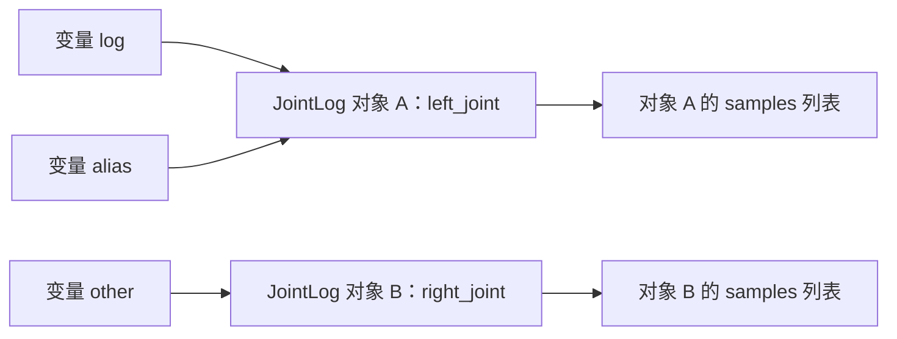

# ENG-01：让 Python 程序有清楚的入口和边界

[学习指南](../学习指南.md) · [本节知识索引](../知识索引.md#eng-01) · [提示与参考答案](../参考答案/ENG-01_参考答案.md) · [下一节 NumPy](ENG-02_NumPy形状广播与计算.md)

<a id="intro"></a>

## 导读

**为什么学这一节。** 脚本一长，就容易分不清数据从哪来、谁修改了列表、为什么导入一个文件也会启动程序。函数、模块与对象正是梳理这些关系的工具。

**学完会有什么变化。** 从逐行模仿语法，进到能追踪调用、返回值、对象状态和异常现场；看到self或共享列表时，也能预测谁会发生变化。

**接下来能做什么。** 可以拆出自己的轨迹读取与验证函数，随后读懂[ROS-01](../../02_ROS2与机器人系统/讲义/ROS-01_节点消息与通信.md#intro)的节点对象，组织[ML-03](../../07_机器学习与深度学习/讲义/ML-03_数据训练验证与恢复.md#intro)中的数据与训练入口。

## 先知道自己要解决什么

轨迹分析先用几个函数就能开始。你要能看清：谁调用谁、数据从哪里传入、结果从哪里返回、对象保存了什么，以及输入无效时在哪里停下来。

W01 优先做函数、模块入口和异常；类用于补理解，不要求先把小脚本设计成复杂框架。

## 资料读到这里

| 资料 | 本次选读 | 读完要能回答 |
|---|---|---|
| [Python 教程第 4 章](https://docs.python.org/3.12/tutorial/controlflow.html) | 4.7 定义函数；4.8 中默认参数，按标题定位 | 形参、实参、return 分别在哪里？默认列表为什么危险？ |
| [第 6 章 Modules](https://docs.python.org/3.12/tutorial/modules.html) | 6.1、6.1.1、6.1.2 | import 会执行哪些顶层语句？主入口如何保护？ |
| [第 9 章 Classes](https://docs.python.org/3.12/tutorial/classes.html) | 9.3.2—9.3.5；9.5 继承只按需 | 对象属性、实例方法、类属性有什么区别？ |
| [第 8 章 Errors and Exceptions](https://docs.python.org/3.12/tutorial/errors.html) | 8.2—8.5、8.8 | 如何读最后一条错误、抛异常和用 with 释放文件？ |

英文读着吃力时，配合[英文选读词汇与长句](ENG-01_英文选读词汇与长句.md)使用：按小节列出可能不认识的词和长句翻译，读原文卡住时当字典查，不要先读译文。

先不深挖装饰器、元类、多重继承和异步。章节编号可能随文档版本变化，同时看标题。当前 3.12 页面上“定义函数”是 4.8，默认参数在 4.9.1。

## 先沿着一个小例子走

```python
class JointLog:
    def __init__(self, name):
        self.name = name
        self.samples = []

    def add(self, position_rad):
        self.samples.append(position_rad)

log = JointLog("left_joint")
alias = log
other = JointLog("right_joint")
alias.add(0.2)
other.add(-0.1)
print(log.name, log.samples)
print(other.name, other.samples)
```

执行时先定义类，然后创建两次实例。`log` 和 `alias` 指向同一个对象，`other` 指向另一个对象。调用 `alias.add(0.2)` 时，Python 将当前对象作为方法的第一个参数传入；方法中的 `self` 因而指向那个对象。



`self.name = name` 左边是保存到对象里的属性，右边是这次调用传入的参数。名字相同是常见写法，二者不是同一个存放位置。`__init__` 在新实例创建后负责初始化；这里需要显式提供 `name`。

换成 `JointLog.add(log, 0.2)` 可以帮助理解绑定方法的调用关系，但平时写 `log.add(0.2)`。

## 学习时盯住这些细节

- **赋值与复制。** `b = a` 让另一个名字关联同一对象；修改列表与重新给变量赋值是两件事。需要独立列表时可用 `a.copy()`；嵌套对象的深浅复制以后再补。
- **实例属性与类属性。** 每次在 `__init__` 中创建 `self.samples = []`，会得到各自的列表。把可变列表放在类体中可能让实例共享它。
- **return 与 print。** 返回值供后续计算，打印供人看。计算函数只 print 而不 return，调用者会得到 `None`。
- **模块导入。** import 需要执行模块顶层的初始化代码。把画图、读文件、启动循环放在顶层，会让别人仅仅导入函数时也触发它们。模块通常被缓存，反复 import 也不等于每次重新执行。
- **错误现场。** 从 traceback 最后一行确认错误类型与信息，再向上找自己代码的调用位置；异常链中要保留上游原因。
- **错误处理的边界。** 检测到无效数据就明确抛错；入口处可以补上下文、打印日志并退出。`except: pass` 会把“失败”藏成“似乎成功”。
- **继承中的初始化。** 子类调用 `super().__init__(...)` 时，参数必须符合父类接口；`super` 不会自动理解你的设备或替你补参数。

## 练习：先预测，再打开答案

<a id="ex1"></a>

### 第 1 题：同一个对象，还是两份数据？约 15 分钟

先写出上例两行输出，再运行。接着依次回答：

1. 如果追加 `alias = other`，再执行 `alias.add(0.5)`，哪个对象改变？
2. 如果把列表改成类体中的 `samples = []`，并移除 `self.samples = []`，新建两个实例各追加一次，会发生什么？
3. 把“变量”和“对象”各用一句话解释给没学过 OOP 的同学。

<a id="ex2"></a>

### 第 2 题：默认参数留下了上一轮的数据。约 20 分钟

预测两次调用返回什么，再修复，让不传 `buffer` 的调用各用自己的新列表；显式传入同一列表时仍能积累。

```python
def collect(value, buffer=[]):
    buffer.append(value)
    return buffer

print(collect(0.1))
print(collect(0.2))
```

解释：为什么每次创建函数的默认列表和每次调用时创建列表，结果不同？

<a id="ex3"></a>

### 第 3 题：为一条两关节样本写接口。约 30 分钟

自己实现 `validate_sample(t_s, q)`：

- `t_s` 是非负、有限的 int/float，布尔值不当作时间。
- `q` 是长度为 2 的 list/tuple，元素是有限 int/float，布尔值不当作关节角。
- 成功返回 `(float(t_s), 新的浮点列表)`，不修改调用者数据；失败抛 `ValueError`，信息指出时间或关节问题。

自己检查正常样本、负时间、错误关节数、NaN，以及返回列表被修改后原列表是否保持不变。这里练基本 Python；NumPy 数组接口放下一节。

<a id="ex4"></a>

### 第 4 题：导入工具，不启动整套程序。约 20 分钟

在你的练习目录中，将第 3 题放入 `trajectory.py`，另建 `main.py` 调用一次。

要求：

1. `python3 -c 'import trajectory'` 没有数据读取、打印和图形窗口。
2. `python3 main.py` 打印一条验证后的样本。
3. 能画出 `main → validate_sample → 返回值 → print` 的调用关系。

自己决定函数拆分，不为这一题引入打包框架。不要将脚本命名为 `json.py`、`numpy.py` 等现用库名。

## 最低验收

能解释第 1 题的对象关系，独立修复第 2 题；第 3、4 题有正常和失败输入的运行证据。W01 时间紧时先做好可用入口与当前数据验证，类的扩展可以回访。

## 直觉与回顾

可以把变量名想成贴在物品上的标签：贴两张标签不等于多了一件物品。`self` 帮助方法找到“这次正在操作哪一件”。类有价值的时刻，是你需要把某份状态和操作长期放在一起；一次输入输出能说清的计算，函数通常就很直接。

异常可以理解成明确退回一张不合格的交接单。继续传一个貌似正常的零值，可能让后面所有曲线都很漂亮，却已经失去解释。

请自己写三句：我原来把哪两个概念混在一起？哪个输出改变了我的判断？回到 ROS 节点时，构造函数、回调和对象状态分别在哪里？

