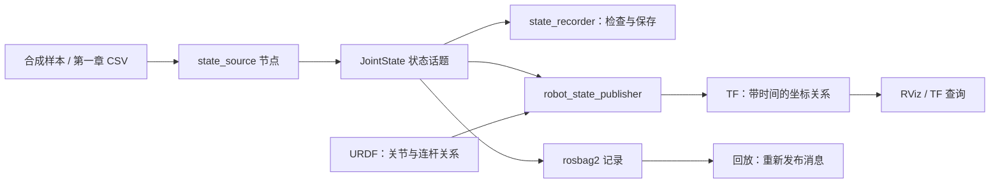

# 第二章怎么学：ROS 2 与机器人系统

[本章概览](README.md) · [知识索引](知识索引.md) · [练习与复盘记录](练习与复盘记录.md) · [第一章](../01_编程与工程基础/学习指南.md) · [第一阶段周计划](../阶段计划/第一阶段_学习范围与周计划.md)

版本：2026-10-29。将 ROS-01—ROS-10 展开为 10 节讲义、40 道练习和独立参考答案。按 W02、W04、W11 以及第二阶段的任务逐步使用，题库不作为一周内全部完成的作业。

## 本章最后要形成什么能力

面对一个小型机器人系统，你能从启动文件找到节点与参数，沿话题追踪数据，解释消息中的名称、坐标和时间，再找到控制器、硬件接口与反馈。出现问题时，知道下一项应检查什么证据。

前置只需第一章的 Python 函数/类/入口、基本数组、终端路径和构建概念；C++ 与高级工程内容随任务补。几何部分跟 W03 机器人学一起学。

## 用同一份数据逐步接成系统

先使用第一章的两关节合成数据。第一步只发合成状态，随后接入 CSV、模型与记录；W11 再单独引入官方模拟硬件的命令链。



这条线先回答“数据怎样被组织、传递和解释”。发布合成 JointState 会让模型显示相应姿态；物理运动来自控制器与执行接口，见 ROS-08。二者各自留下验证证据。

## 十节导航

| 讲义 | 核心问题 | 建议使用时机 | 答案 |
|---|---|---|---|
| [ROS-01 节点、消息与通信](讲义/ROS-01_节点消息与通信.md) | 谁在发布什么，接收者怎样解释？ | W02 主线；服务/动作先理解和调用现成接口 | [提示与答案](参考答案/ROS-01_参考答案.md) |
| [ROS-02 包、启动与参数](讲义/ROS-02_包启动与参数.md) | 源码怎么变成可启动系统，参数在哪生效？ | W02；C++ 包跟 W05 | [提示与答案](参考答案/ROS-02_参考答案.md) |
| [ROS-03 QoS、执行器与回调](讲义/ROS-03_QoS执行器与回调.md) | 同名话题为什么收不到，回调为什么延迟？ | W02 先 QoS；阻塞与并发按需 | [提示与答案](参考答案/ROS-03_参考答案.md) |
| [ROS-04 URDF、Xacro 与模型](讲义/ROS-04_URDFXacro与模型.md) | 连杆关系怎样成为可显示的机器人？ | W04，复用 W03 的二维 2R 模型 | [提示与答案](参考答案/ROS-04_参考答案.md) |
| [ROS-05 TF2 与坐标查询](讲义/ROS-05_TF2与坐标查询.md) | 查到的变换究竟把谁变到哪里？ | W04；第二阶段接相机 | [提示与答案](参考答案/ROS-05_参考答案.md) |
| [ROS-06 时间戳、同步与时钟](讲义/ROS-06_时间戳同步与时钟.md) | 数据是什么时刻的，不同时间能否直接相减？ | W02 先时间戳；W04/第二阶段逐步补齐 | [提示与答案](参考答案/ROS-06_参考答案.md) |
| [ROS-07 记录、回放与复现](讲义/ROS-07_记录回放与复现.md) | 如何保留现场，并让输入再次出现？ | W02；模型与感知阶段继续用 | [提示与答案](参考答案/ROS-07_参考答案.md) |
| [ROS-08 ros2_control 与执行接口](讲义/ROS-08_ros2_control与执行接口.md) | 命令经过谁，状态从哪里回来？ | W11，官方 RRBot 模拟硬件 | [提示与答案](参考答案/ROS-08_参考答案.md) |
| [ROS-09 传感器消息与驱动边界](讲义/ROS-09_传感器消息与驱动边界.md) | 设备字节怎样变成带单位和时间的消息？ | 第二阶段为主；W02 不写真实驱动 | [提示与答案](参考答案/ROS-09_参考答案.md) |
| [ROS-10 排错、状态与停止条件](讲义/ROS-10_排错状态与停止条件.md) | 怎样判断系统状态，停止请求到达了哪层？ | 基础日志现在用；执行部分跟 W11 | [提示与答案](参考答案/ROS-10_参考答案.md) |

阅读路线：ROS-01 → ROS-02 → ROS-03 基础 → ROS-06 基础 → ROS-07；跟随几何任务进入 ROS-04/05；跟随执行任务进入 ROS-08/10；ROS-09 随传感需求展开。

## 练习环境先确认

本章以 Ubuntu 24.04、ROS 2 Jazzy、兼容的 Python 环境为基准。使用已有可用安装，不要求现在重装。打开独立练习终端，先核对：

```bash
source /opt/ros/jazzy/setup.bash
command -v ros2
printf '%s\n' "$ROS_DISTRO"
/usr/bin/python3 -c 'import sys, rclpy; print(sys.executable); print(rclpy.__file__)'
ros2 interface show sensor_msgs/msg/JointState
```

若安装位置不同，按实际路径 source。第一章用于数值练习的 Python 不自动等于 ROS 二进制兼容的 Python，先以导入和实际入口确认。

个人练习与实验室系统使用不同且确认空闲的 domain；所有练习终端保持一致。例如仅在练习终端中：

```bash
export ROS_DOMAIN_ID=87
export ROS_AUTOMATIC_DISCOVERY_RANGE=LOCALHOST
```

87 是示例值，不保证在你的机器上空闲。常见 DDS RMW 支持上述发现范围设置；其他 RMW 按其实现检查。domain 用于隔开发现范围，不是权限控制。[官方发现配置说明](https://github.com/ros2/ros2_documentation/blob/jazzy/source/Tutorials/Advanced/Improved-Dynamic-Discovery.rst)

先只加载 Jazzy 与你自己的学习工作空间，检查包路径。不要把实验室驱动启动文件用作本章的消息练习入口。这里的发送练习只面向合成节点与明确启动的模拟硬件。

## 统一名称与数据约定

| 项目 | 本章约定 |
|---|---|
| 自己的学习包 | `trajectory_demo`，由你创建与组织 |
| 命名空间 | `/learn_ch2` |
| 节点名 | `state_source`、`state_recorder`；均是本章自定义名称 |
| 状态话题 | `/learn_ch2/joint_states`，sensor_msgs/msg/JointState |
| 自建模型关节顺序 | `["joint_1", "joint_2"]` |
| 自建模型坐标 | `base_link → link1 → link2 → tool0` |
| 数值 | 旋转关节 rad，时间 s；内部时间比较优先整数 ns |
| 数据来源 | 合成样例；不能标为编码器反馈 |

RRBot 是另一套模型/配置，关节名通常为 joint1、joint2 或按前缀生成，必须读其实际配置，不能直接套用本章的下划线名称。ROS 命名空间也不会自动给 TF 的 frame_id 加前缀。

第一章 CSV 的 t_s 是样例相对时间。W02 可先按定时器取行，在消息中用当前 ROS 时钟标记“本次合成采样时刻”，原 t_s 留在输入文件中。这样练的是当前流式发布；如果要保留原采集时序，应另定义时间映射与调度，见 ROS-06。不要把相对秒直接冒充真实采集绝对时间。

JointState 的位置是各关节自身坐标，不是可直接用一个 TF 旋转的三维点。name 与 position 的对应，以及 URDF 中的关节定义共同决定含义。

## W02 怎样安排约 8 小时

第一次可以只做约一小时：环境检查 → 阅读 ROS-01 的小发布者并预测完整名称 → 运行/检查一条合成消息 → 写出 main、spin、回调与消息的关系。接着做 ROS-01 第 2 题的名字映射，不需要立即展开全部 40 题。

| 环节 | 选读和练习 | 参考投入 |
|---|---|---|
| 环境与图 | 上述检查；ROS-01 第 1 题 | 30 分钟 |
| 发布订阅 | ROS-01 第 2、3 题；先合成数据再接 CSV | 90—120 分钟 |
| 包和启动 | ROS-02 第 1、2 题；第 3 题先启动参数部分 | 90—120 分钟 |
| QoS 与时间 | ROS-03 第 1 题；ROS-06 第 1 题 | 40—60 分钟 |
| 记录回放 | ROS-07 第 1、2 题 | 60—90 分钟 |
| 独立复跑与解释 | 改一个参数，画数据流，留下命令和差异 | 30—45 分钟 |

估时用于控制范围，预留余量处理环境；W02 仍以“两个节点、一个 launch、录包/回放证据”为核心。自写动作服务端、并发、真实驱动和控制器全部展开会超出本周范围，随对应任务再补。

## 每次怎样学习和复盘

1. 先看一条输入到输出的链，预测节点、话题或坐标关系。
2. 阅读本节表里对应的一小段官方资料。
3. 只启动这次需要的合成节点，用 CLI 或数值例子观察。
4. 人为改错一项，例如关节名、QoS 或时间设置，说明证据发生了什么变化。
5. 修复后独立复跑，记录 3—5 句理解与下一步。

答案分别存放，先尝试再看提示。代码块会注明完整程序或局部片段；不能把只有 self 的构造函数片段当成独立脚本执行。

各节末尾的“直觉与回顾”用于帮你建立联系；个人感想由你写进[练习与复盘记录](练习与复盘记录.md)。可以写“以前我只看 topic list，现在会核对消息来源、QoS 和采样时间”，并附一个自己的例子。

## 无真机与中断方案

所有必学阶段都有无真实设备路径：合成 JointState、标准消息对象、CSV、URDF、TF Buffer、rosbag 与官方模拟硬件。没有 GUI 时保存 TF 数值和模型检查结果；没有传感器时用合成 Image 与字节流。

如果一时没有 ROS 环境，可先做消息字段/形状、时间算术、变换矩阵和协议题，保存预期；真实 ROS 收发、录包与回放仍单列为待验证，不能用纸面回答抵扣运行证据。

被插单时留下：当前包路径、已 source 的环境、运行命令、话题/节点名、已通过检查、下一步。熟悉的内容通过小验证跳过，实验室任务符合相同证据要求时可以抵扣。

## 资料版本和验证范围

教程优先固定 Jazzy；网页遇到访问验证时可打开各节对应的官方仓库源文件。ros2_control 文档和 demos 也使用 Jazzy 分支，具体配置可能随补丁变化。

本次环境中已安装 Jazzy、消息库、TF2、rosbag2、robot_state_publisher 等，RRBot 演示包未安装。工具沙箱的 UDP 受限，同进程消息收发和离线检查，与跨进程发现、GUI、模拟控制器和真机运行分别记录。具体结果见[示例核对记录](示例核对记录.md)。

