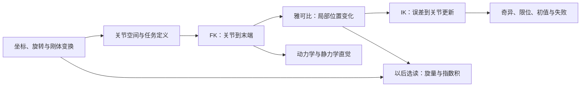

# 第三章怎么学：机器人学基础

[本章概览](README.md) · [知识索引](知识索引.md) · [练习与复盘记录](练习与复盘记录.md) · [第二章](../02_ROS2与机器人系统/学习指南.md) · [第一阶段计划](../阶段计划/第一阶段_学习范围与周计划.md)

版本：2026-10-29。将 KIN-01—KIN-09 展开为 9 节讲义、36 道自编练习与独立参考答案，另配数值图示。题目随 W03、W04、W06 和后续控制任务使用，不要求一次学完整章。

## 本章要得到的能力

给你关节角，能算末端在哪里；给你一个目标，能检查可达性并尝试求关节角；算法结果异常时，能用坐标、单位、雅可比、初值与限位逐项验证。

前两章让数据流起来，这一章解释其中的几何和物理含义。继续使用同一台平面两转动关节机械臂，先手算、再实现、再用独立方法核对。

## 九节导航

| 讲义 | 核心问题 | 本期深度与时机 | 答案 |
|---|---|---|---|
| [KIN-01 坐标与变换方向](讲义/KIN-01_坐标与变换方向.md) | 同一个点为什么有不同坐标？ | W03 必学；已有 ROS-05 结果可直接抵扣 | [提示与答案](参考答案/KIN-01_参考答案.md) |
| [KIN-02 旋转、位姿与四元数](讲义/KIN-02_旋转位姿与四元数.md) | 怎样表示并检查方向和位姿？ | W03 学矩阵，四元数先会使用 | [提示与答案](参考答案/KIN-02_参考答案.md) |
| [KIN-03 关节空间、工作空间与限位](讲义/KIN-03_关节空间工作空间与限位.md) | 哪些目标可能有解？ | W03 基础；规划阶段继续用 | [提示与答案](参考答案/KIN-03_参考答案.md) |
| [KIN-04 正运动学 FK](讲义/KIN-04_正运动学FK.md) | 一串关节角如何决定末端位置？ | W03 主成果，W04 对照模型 | [提示与答案](参考答案/KIN-04_参考答案.md) |
| [KIN-05 雅可比与局部运动](讲义/KIN-05_雅可比与局部运动.md) | 每个关节动一点，末端怎样动？ | W06 自己推导并用有限差分核对 | [提示与答案](参考答案/KIN-05_参考答案.md) |
| [KIN-06 解析与数值 IK](讲义/KIN-06_解析与数值IK.md) | 怎样从目标求关节角，怎样报告失败？ | W06 做二维位置 IK | [提示与答案](参考答案/KIN-06_参考答案.md) |
| [KIN-07 奇异、冗余与零空间](讲义/KIN-07_奇异冗余与零空间.md) | 为什么会大步、停滞或有多个解？ | W06 观察奇异；冗余/零空间了解即可 | [提示与答案](参考答案/KIN-07_参考答案.md) |
| [KIN-08 动力学与静力学直觉](讲义/KIN-08_动力学与静力学直觉.md) | 运动还取决于哪些力与惯性？ | W07/W08 先物理含义与单关节例子 | [提示与答案](参考答案/KIN-08_参考答案.md) |
| [KIN-09 旋量、李群与指数积](讲义/KIN-09_旋量李群与指数积.md) | 论文和库里的 SE(3)、twist 指什么？ | 先能辨认，研究需要时深入 | [提示与答案](参考答案/KIN-09_参考答案.md) |

完整 SE(3) 数值 IK、全套动力学推导、闭链和接触约束均留以后。KIN-09 的选读不作为第一阶段结项门槛。

## 固定几何与接口，减少反复搭例子

| 项目 | 本章约定 |
|---|---|
| 几何 | L1=0.3 m，L2=0.2 m；运动平面 xy，两个轴沿 +z |
| 零位 | 两段都沿基座 +x，tool0 在 (0.5,0,0) |
| 关节 | q=[q1,q2]，q2 相对第一段转动，单位 rad |
| 模型名 | joint_1、joint_2；base_link → link1 → link2 → tool0 |
| 点与矩阵 | 列向量，T_A_B 将 B 坐标变到 A 坐标 |
| 位置任务 | x=[px,py]，单位 m；位置 IK 只约束这两项 |
| 位置雅可比 | J_xy 为 2×2，dx≈J_xy dq，单位 m/rad |
| 完整平面位姿 | 还包括 yaw=q1+q2，不能任意独立指定 x/y/yaw 三项 |
| 动力学例子 | 单独声明安装平面、重力方向、惯量和力的符号 |

没有限位、障碍时，末端位置半径在 0.1—0.5 m。加入关节限位后还需检查关节解，不能只看这个圆环。

Modern Robotics 常使用 6×n 的空间/本体雅可比，速度顺序为 [角速度;线速度分量]。它与本章 J_xy 的定义不同；不能直接截取几行替代，见 KIN-09。

## 第一次先做约一小时

1. 看 KIN-01 的约定，手算第 1 题的同一点坐标与逆变换。
2. 做 KIN-02 第 1 题中绕 z 的 90°，预测 (1,0,0) 会到哪里，再运行。
3. 画两根线段的零位，说明 q2 是相对角还是绝对角，写一句自己的理解。

如果第二章同类坐标题已独立验收，直接链接旧结果，再进入 KIN-04 的 FK，不重做一套 TF 节点。

## W03：坐标与 FK 的约 8 小时

| 环节 | 选读和实践 | 参考投入 |
|---|---|---|
| 固定约定 | KIN-01 方向、单位、点与向量 | 30—45 分钟 |
| 旋转与位姿 | KIN-02 矩阵及第 1、3 题 | 60—90 分钟 |
| 目标与限制 | KIN-03 第 1、2 题 | 30—45 分钟 |
| 实现 FK | KIN-04 推导、实现、矩阵对照 | 90—120 分钟 |
| 三组几何核对 | 手画/数值/简单图，与第二章模型约定相连 | 45—60 分钟 |
| 整理证据 | 参数、运行命令、数值表、一项独立修改 | 30—45 分钟 |

留出余量处理数学薄弱点。W03 交付仍是 FK、机械臂图与三组已知姿态核对；雅可比与 IK 不提前变成本周任务。

## W06：雅可比与 IK 的约 8 小时

| 环节 | 实践 | 参考投入 |
|---|---|---|
| 推导雅可比 | KIN-05 第 1 题 | 45—60 分钟 |
| 差分与局部近似 | KIN-05 第 2、3 题 | 45—60 分钟 |
| 解析解作参照 | KIN-06 第 1 题，验证分支 | 30—45 分钟 |
| 数值 IK | 自己按流程写，再对照局部参考实现 | 90—120 分钟 |
| 初值与失败 | KIN-06 第 3 题、KIN-07 奇异观察 | 60—90 分钟 |
| 留下结果 | 收敛曲线、最终残差、迭代数、退出原因 | 30—45 分钟 |

一次失败也是可验收成果的一部分，前提是输入、过程、原因与下一项检查清楚。不要只展示最好的一条曲线。

## 资料怎样读

主线是 [Modern Robotics 免费教材入口](https://hades.mech.northwestern.edu/index.php/Modern_Robotics) 与[配套视频目录](https://modernrobotics.northwestern.edu/nu-gm-book-resource/)：第 2 章选空间概念，第 3 章选旋转/变换，第 4—6 章服务 FK/雅可比/IK，第 8 章先物理含义。

教材用旋量建立统一框架；本章先用二维三角几何与求导搭可验证的例子，再回看一般表达。每节列明具体选读位置，遇到完整六维证明可先记录问题。

数学不足时查[公共基础](../00_公共基础与学习方法/知识索引.md)和 [MML 第 2—4 章](https://mml-book.github.io/)的矩阵、几何与分解；先解决当前一道题，不额外开一轮整本数学课。

这里的 36 题为自编练习，参考答案不是教材受限习题的官方题解。看提示后完成可如实记录，之后关掉答案换一个输入再验证。

## 实现、图示与中断恢复

建议把自己的纯数值函数逐步放进一个 kinematics.py，例如 fk_xy、jacobian_xy、analytic_ik_2r；在独立小脚本中运行例子。各节注明前置函数，参考片段由你组织成项目。

[图示说明](图示/README.md)记录了教材图的参数与来源；图是帮助理解的参考材料，不代表你的练习已经完成。所有核心几何题可只用 NumPy；四元数可用已有 SciPy 或明确约定的成熟实现；不需要 GPU 与真机。

每次保留：约定、输入与初值、预期、实际误差、退出原因、代码/数据位置、下一步。已有第二章结果直接复用。需要硬件/GUI 的附加验证与纯数值结果分别记录。

每节末尾有“直觉与回顾”，把自己的总结写进[练习与复盘记录](练习与复盘记录.md)。本次教材数值与交叉核对范围见[示例核对记录](示例核对记录.md)。

