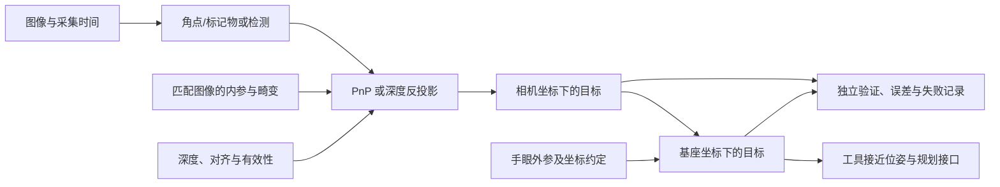

# 第五章怎么学：机器人感知与视觉

[本章概览](README.md) · [知识索引](知识索引.md) · [练习与复盘记录](练习与复盘记录.md) · [第三章](../03_机器人学基础/学习指南.md) · [第四章](../04_机器人控制与运动规划/学习指南.md) · [第二阶段周计划](../阶段计划/第二阶段_学习范围与周计划.md)

版本：2026-10-30。9 节讲义、36 道自编练习、独立答案、图示与核对记录。主要用于第二阶段 W14—W17、W20—W21；检测/分割为扩展，视觉伺服、SLAM 与触觉为后续入口。

## 学完主线，要能交付什么

把一次图像观测变成带坐标、单位、时间、标定版本和失败状态的目标估计，交给后续规划。能够说明误差来自哪里，以及哪些结果还没有验证。



每条箭头都要能用一个小例子核对。像素定位、相机三维定位、外参转换和机器人到达分别验证。

## 九节导航与先后顺序

| 讲义 | 先解决什么 | 本期范围 | 答案 |
|---|---|---|---|
| [VIS-01 图像、像素与 OpenCV](讲义/VIS-01_图像像素与OpenCV.md) | 行列、颜色、dtype 与尺寸 | W14 必学，沿用工程基础 | [提示与答案](参考答案/VIS-01_参考答案.md) |
| [VIS-02 相机模型与投影/反投影](讲义/VIS-02_相机模型与投影反投影.md) | 像素为什么不能单独决定三维点 | W14 必学，畸变处理到会用 | [提示与答案](参考答案/VIS-02_参考答案.md) |
| [VIS-03 内参标定与独立验证](讲义/VIS-03_内参标定与独立验证.md) | 参数怎样估计，怎样检查可信范围 | W15 主线 | [提示与答案](参考答案/VIS-03_参考答案.md) |
| [VIS-04 标记物与 PnP 位姿](讲义/VIS-04_标记物与PnP位姿.md) | 图像对应点怎样得到 T_camera_target | W16 主线，先选一种标记物 | [提示与答案](参考答案/VIS-04_参考答案.md) |
| [VIS-05 深度、RGB-D 与点云](讲义/VIS-05_深度RGBD与点云.md) | 深度值、尺度、对齐和无效值 | W16 做小例子，完整点云选读 | [提示与答案](参考答案/VIS-05_参考答案.md) |
| [VIS-06 手眼标定与坐标闭合](讲义/VIS-06_手眼标定与坐标闭合.md) | 相机与机器人怎样连接 | W17 主线，先固定外置相机布局 | [提示与答案](参考答案/VIS-06_参考答案.md) |
| [VIS-07 检测、分割与定位接口](讲义/VIS-07_检测分割与定位接口.md) | 模型输出怎样接入定位 | 了解；核心成果完成后选做 | [提示与答案](参考答案/VIS-07_参考答案.md) |
| [VIS-08 时序、误差与评测](讲义/VIS-08_时序误差与评测.md) | 为什么单模块正常，整体仍偏移 | W16 起贯穿，W20—W21 集成 | [提示与答案](参考答案/VIS-08_参考答案.md) |
| [VIS-09 视觉伺服、SLAM 与触觉导读](讲义/VIS-09_视觉伺服SLAM与触觉导读.md) | 连续反馈、建图与接触观测 | 以后深入；不是 P2 结项门槛 | [提示与答案](参考答案/VIS-09_参考答案.md) |

主线 VIS-01→02→03→04→06；VIS-05 作为另一种三维信息来源，VIS-08 贯穿验证。预训练网络不用先学完才开始标定。

## 统一的小例子

| 项目 | 本章参考约定 |
|---|---|
| 图像 | 640×480，即 width×height；数组灰度 (480,640)，彩色 (480,640,3) |
| 像素 | (u,v)=(列,行)，数组索引 image[v,u] |
| 光学坐标 | x 向右、y 向下、z 向前，三维点用米 |
| 演算内参 | fx=600、fy=620、cx=320、cy=240，焦距/主点以像素计 |
| 演算畸变 | (k1,k2,p1,p2,k3)=(-0.12,0.03,0.001,-0.001,0)，标准针孔模型；理想题明确设零 |
| 棋盘格 | 9×6 个内角点、格长 0.025 m；第一内角点为原点，行内 x 递增、逐行 y 递增 |
| 变换 | 沿用第三章 T_A_B：B 坐标的量变换到 A |
| 手眼主线 | 相机固定于外部，标定板刚性安装在工具上；相机、基座、工具、板四帧分别命名 |

这些是教学参数，不是实验室相机的实测参数。公开标定图像、合成手眼位姿和真实平台可分别练习；集成时必须换成同一相机、分辨率、外参与场景。

## 环境先检查，按版本查资料

本次用于数值核对的是系统 Python 3.12、OpenCV 4.6.0、NumPy 1.26.4、SciPy 1.11.4。本机有 aruco 和 calibrateHandEye，未提供新版 ArucoDetector 类。

学习时先记录自己的版本与功能：

```python
import cv2 as cv
print(cv.__version__)
print(hasattr(cv, "aruco"))
print(hasattr(getattr(cv, "aruco", None), "ArucoDetector"))
```

核心例子沿用已有 OpenCV，无需 GPU。优先读 [4.6 标定教程](https://docs.opencv.org/4.6.0/dc/dbb/tutorial_py_calibration.html)和 [4.6 API](https://docs.opencv.org/4.6.0/d9/d0c/group__calib3d.html)；访问 4.x 在线页面时，它可能指向较新版本，调用写法要和本机对应。先检查已有环境，确需补依赖时再隔离安装，避免覆盖 ROS 使用的系统依赖。

## 第一次约一小时

1. 读一张图，记录 shape、dtype 和颜色约定，标注一个已知像素。
2. 手算相机点 (0.1,0.05,1) m 的理想投影。
3. 自己实现理想投影，再与 cv.projectPoints 的零畸变结果对照。
4. 用给定 Z 恢复三维点，并解释去掉 Z 后为什么不唯一。

这一小时的成果是一张标注图和一次数值往返检查。后面每次围绕一个能验收的问题推进。

## 对应周计划怎样选题

| 周次 | 核心动作 | 当周成果 |
|---|---|---|
| W14 | VIS-01 第 1—3 题、VIS-02 第 1—3 题，畸变第 4 题先会查 API | 图像约定表、投影/反投影检查 |
| W15 | VIS-03 第 1—4 题，复用 VIS-01 第 4 题 | 标定文件、采集覆盖、逐图误差与留出验证 |
| W16 | VIS-04 第 1—3 题，VIS-05 第 1—2 题，VIS-08 时间检查 | 位姿叠加图、相机目标位姿、深度小例子与失败记录 |
| W17 | VIS-06 第 1—4 题，先无噪声三维合成数据 | 一种布局的外参、变换闭合与退化案例 |
| W20—W21 | VIS-08 第 2—4 题，复用前面模块接规划 | 完整定位输入、误差分层、全部预定试验结果 |

每周沿用约 8 小时核心预算：约 2 小时读/推导、5 小时实现与对照、1 小时记录，另留 2—4 小时机动。表内练习服务于原周成果；熟悉的检查可以抵扣，不另外叠加一套项目。

手眼需要三维姿态覆盖；第一阶段的平面 2R 继续用于理解变换，但不能代替非退化的通用手眼采集。没拿到设备时，用合成配对位姿先验证数学。

## 每次实践保留什么

先预测→自己实现→保存原始输入与参数→检查数值和失败→再看答案→换一项条件复做。角点顺序、图像尺寸、长度单位、变换方向和采集时间都写进记录。

参考答案只提供局部函数、手算与验收思路。图像采集、项目组织、配置读写、完整管线与自己的实验报告由你完成。每节的“直觉与回顾”提供一个理解角度，自己的感想记在[复盘表](练习与复盘记录.md)。

## 成果与证据层次

理论层可以验证公式；合成角点可以验证标定数值；合成标记物图像可以验证检测接口；真实图像、相机安装与机器人定位还需独立测量。

[图示说明](图示/README.md)列模型与参数；[示例核对记录](示例核对记录.md)列实际运行范围。参考曲线和答案不代填学习进度。毕业项目逐步保留原始数据、标定版本、留出误差、失败案例和可复跑入口。

