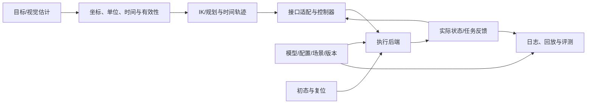

# 第六章怎么学：仿真与系统集成

[本章概览](README.md) · [知识索引](知识索引.md) · [练习与复盘](练习与复盘记录.md) · [第四章](../04_机器人控制与运动规划/学习指南.md) · [第五章](../05_机器人感知与视觉/学习指南.md) · [第一阶段](../阶段计划/第一阶段_学习范围与周计划.md) · [第二阶段](../阶段计划/第二阶段_学习范围与周计划.md)

版本：2026-10-30。10 节讲义、40 道自编练习、独立答案、三个小模型与图示。按项目进度选择，Gymnasium、域随机化与双臂扩展不增加前两阶段结项门槛。

## 这章最终要做到什么

从一个可复跑的仿真例子，逐步接通目标、参考、执行、反馈、日志与评测。能够独立改一项输入、解释结果，并定位失败发生在哪一层。



先用离线文件连接已验证模块，再按需要做在线接口。每个新增环节都有明确输入、输出、时间和失败状态。

## 十节导航

| 讲义 | 要解决的问题 | 本期范围 | 答案 |
|---|---|---|---|
| [SIM-01 模型加载、循环与状态](讲义/SIM-01_模型加载循环与状态.md) | 怎样让模型真正随输入演化 | W07 主线 | [提示与答案](参考答案/SIM-01_参考答案.md) |
| [SIM-02 执行器与控制语义](讲义/SIM-02_执行器与控制语义.md) | ctrl 代表什么，怎样找到对应状态 | W07，连接 CTRL-03 | [提示与答案](参考答案/SIM-02_参考答案.md) |
| [SIM-03 多种时间、渲染与接触](讲义/SIM-03_时间渲染与接触.md) | 步长/控制/显示怎样分开，接触怎样检查 | W07 基础，接触选读 | [提示与答案](参考答案/SIM-03_参考答案.md) |
| [SIM-04 MoveIt 模型、场景与执行](讲义/SIM-04_MoveIt模型场景与执行.md) | 一个规划请求经过哪些配置 | 第二阶段 W18 | [提示与答案](参考答案/SIM-04_参考答案.md) |
| [SIM-05 mock、可视化与物理证据](讲义/SIM-05_mock可视化与物理证据.md) | 当前成功证明了哪件事 | W11 起贯穿 | [提示与答案](参考答案/SIM-05_参考答案.md) |
| [SIM-06 模型与接口适配](讲义/SIM-06_模型与接口适配.md) | 名字、单位、符号和坐标怎样衔接 | W12—W13、W20 | [提示与答案](参考答案/SIM-06_参考答案.md) |
| [SIM-07 复位、种子与重复评测](讲义/SIM-07_复位种子与重复评测.md) | 怎样公平复跑、保存失败 | W07 先复位，结项时完整使用 | [提示与答案](参考答案/SIM-07_参考答案.md) |
| [SIM-08 Gymnasium 与环境接口](讲义/SIM-08_Gymnasium与环境接口.md) | step/reset、动作和结束怎样定义 | 第三阶段 IL/RL 前选学 | [提示与答案](参考答案/SIM-08_参考答案.md) |
| [SIM-09 域随机化与迁移](讲义/SIM-09_域随机化与迁移.md) | 换模型/延迟后为什么退化 | 了解/以后深入 | [提示与答案](参考答案/SIM-09_参考答案.md) |
| [SIM-10 双臂、接触与部署导读](讲义/SIM-10_双臂接触与部署导读.md) | 增加机器人/约束后怎样保持系统可解释 | 研究任务需要时深入 | [提示与答案](参考答案/SIM-10_参考答案.md) |

先学 SIM-01/02/03/07 的基础；已经有机器人学与控制结果后接 SIM-05/06；标准规划器到 W18 再加入。无需先学完 RL、完整接触动力学或实时桥接。

## 三个模型分别用来做什么

| 文件 | 用途与边界 |
|---|---|
| [单关节转子](模型/单关节转子.xml) | I_z=0.05 kg·m²、阻尼 0.1 N·m·s/rad，无重力、单 motor；便于和第四章力矩模型对照 |
| [平面双关节](模型/平面双关节.xml) | L1=0.3 m、L2=0.2 m，joint_1/2、tool0，与第三章几何对应；含指定质量/惯量，没有启用碰撞 |
| [球落地](模型/球落地.xml) | 自由球与地面，单独观察重力、自由关节和软接触；不是机械臂或抓取模型 |

双关节的惯量是本模型参数，不能当成实验室机构实测值；与 URDF 对齐几何不等于动力学参数也相同。无碰撞的教学模型不能用于验证避障。

本章沿用 SI、rad、T_A_B；MuJoCo 的 freejoint 四元数顺序与 ROS 消息有差异，见 SIM-06。

## 环境怎样安排

参考核对使用 Python 3.12.3，临时隔离环境中的 MuJoCo 3.17.0、Gymnasium 1.4.0、NumPy 2.5.4；绘图沿用系统 Python/Matplotlib。没有修改 ROS 系统环境。

学习时先检查自己所用解释器，再在个人隔离环境安装所需包。普通 Ubuntu 可在已有 python3-venv 条件下创建环境；若缺少 venv/ensurepip，先处理环境问题，不把系统 Python 和 Conda 的 pip 混用。安装后记录解释器绝对路径与包版本：

正式学习在已具备 venv 条件时，可在自己的练习工程建立独立环境并冻结本次版本：

```bash
/usr/bin/python3 -m venv .venv-sim
.venv-sim/bin/python -m pip install "mujoco==3.17.0" "gymnasium==1.4.0" "numpy==2.5.4"
```

当前核对环境在 /tmp/ch6_check_env，可能被系统清理；它不是长期项目环境，也不应作为以后启动脚本的固定路径。上面的安装步骤用于你自己的学习环境，本次实际核对采用临时环境。

```python
import sys
import mujoco
print(sys.executable)
print(mujoco.__version__)
```

先无界面加载和推进，再按需打开 viewer。本次没有运行 GUI/离屏相机渲染；图示来自仿真状态和数值数据。MuJoCo 的 [3.17 Python 文档](https://mujoco.readthedocs.io/en/3.17.0/python.html)与 [XML 参考](https://mujoco.readthedocs.io/en/3.17.0/XMLreference.html)匹配本次例子；其他版本按实际核对。

本机只有 move_group 包，未找到 Panda 演示配置、moveit2_tutorials 与 RRBot 示例包；W18/W11 的完整框架运行项仍需在对应环境完成。

## 第一次约一小时

1. 读单关节 XML：指出关节、惯量、阻尼、motor、gear、ctrlrange 和物理步长。
2. 加载模型，打印 nq/nv/nu 与名称，复位到一个已知状态。
3. 应用一个小力矩、推进固定步数，记录时间、q/qd 和实际广义执行器力。
4. 再复位复跑，检查数组日志是否用了 copy。

这一小时留下一个模型说明和状态曲线。反馈控制复用第四章，不再重写一份 PID。

## 怎样接回原周计划

| 周次 | 本章选学 | 原有成果 |
|---|---|---|
| W07 | SIM-01/02，SIM-03 第 1—2 题，SIM-07 复位 | 状态、输入与时间可解释的仿真记录 |
| W08/W10 | 用模型接第四章控制与轨迹 | 参考/实际/控制对照与到达实验 |
| W11 | SIM-05，对照第二章 ros2_control | 接口链和 mock 反馈证据 |
| W12/W13 | SIM-06/07，复用已有数据读写与回放 | P1 可复跑入口和失败解释 |
| W18 | SIM-04，复用 CTRL-06 | 标准模型带障碍规划与请求结果 |
| W20/W21 | SIM-06/07，结合 VIS-08 | 同一配置的感知→规划→模拟执行与评测 |
| 第三阶段 | SIM-08 基础，SIM-09 按选题 | 为 IL/RL 准备环境/动作/评测契约 |

每周仍为约 8 小时核心任务加 2—4 小时机动。这里是原任务的配套材料；熟悉的部分直接验收。环境受阻时先用第四章数值模型、消息对象、日志与合成坐标做接口练习，把框架运行缺口记入缓冲周。

## 集成项目怎样逐步长出来

P1 先复用 FK/IK→关节轨迹→仿真控制→日志→ROS/RViz 回放，允许离线串联。P2 在标准三维模型中加入真实估计来源、标定版本、碰撞场景和规划；是否有物理执行按证据说明。

最小联调一次只接一个接口：固定输入、检查输出，再替换成上游真实输出。收到错误值或失效状态要留下原因，不能静默用真值或旧目标绕过去。

参考答案是小函数、手算和验证思路；完整驱动、实时桥接、自建 RL 环境和项目组织由你完成。[图示说明](图示/README.md)列模型与参数，[核对记录](示例核对记录.md)列实际运行范围，[复盘表](练习与复盘记录.md)留给自己的实验。

