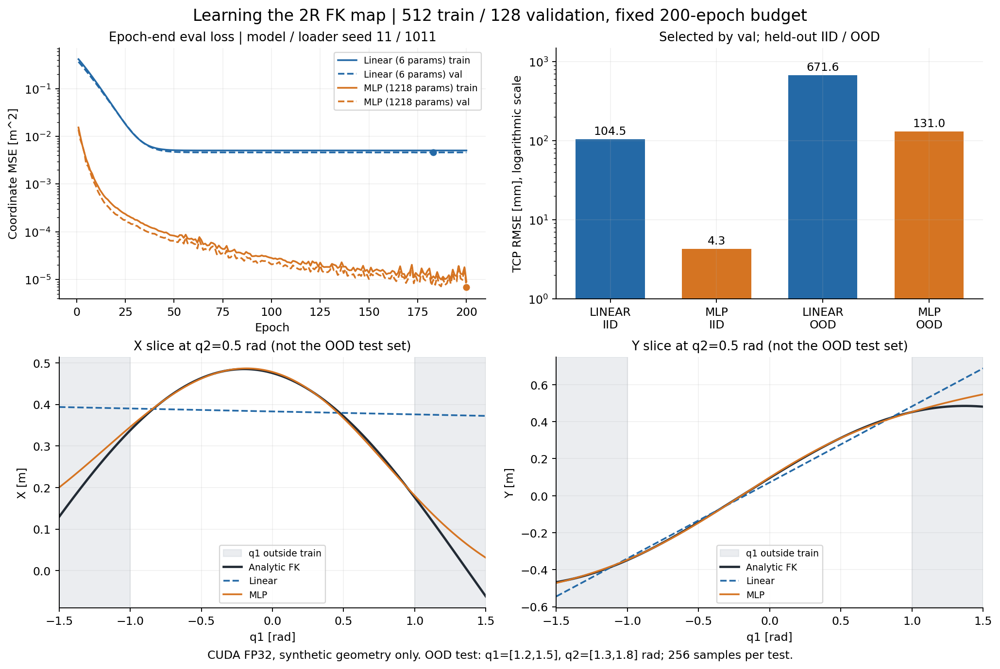
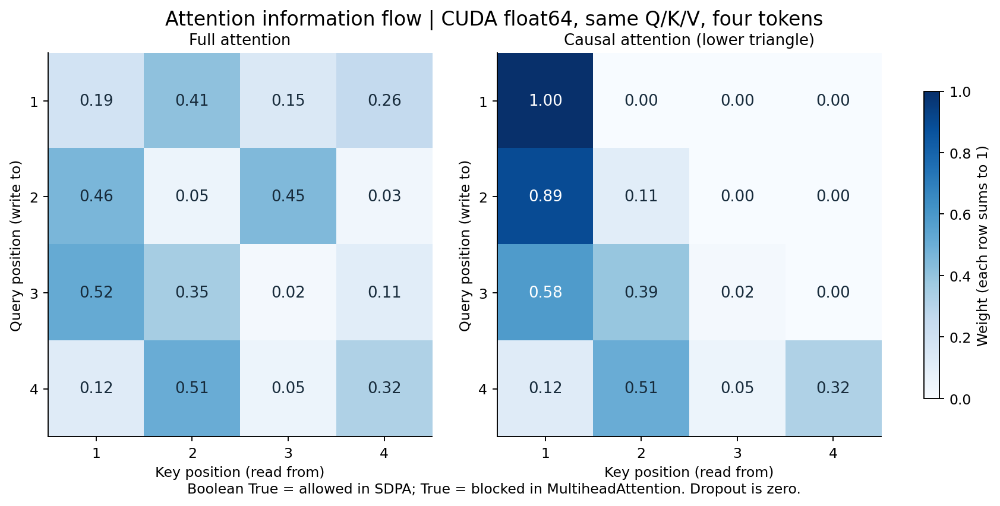
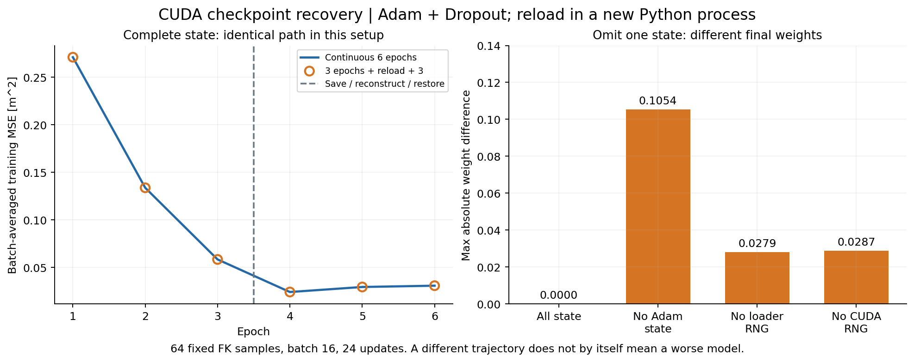
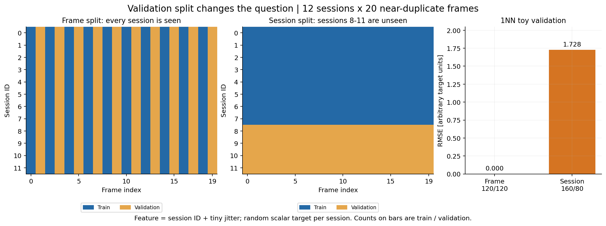
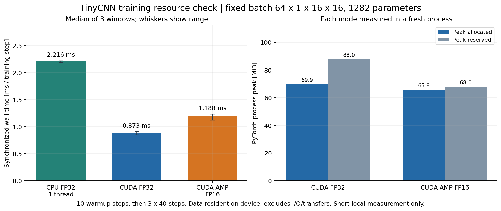

# 第七章图示：看曲线前先读实验条件

[学习指南](../学习指南.md) · [实际核对记录](../示例核对记录.md) · [原始数值](../实验数据/CPU与GPU复核结果.json) · [绘图数组](参考实验数组.npz)

版本：2026-10-30，第二版。训练主图与恢复图已使用本次 CUDA 重跑结果，注意力用 CUDA float64；划分演示仍用 NumPy/CPU，资源图同时比较 CPU/CUDA。图内用英文标轴，中文解释列在这里。它们是参考观察，不代表你的学习项目已验收。

## 训练、验证与范围外误差

左上：CUDA FP32 每轮结束后，以 eval 模式重算 train/val 坐标 MSE，单位 m²；实线 train、虚线 val，圆点是按 val 选中的 checkpoint。两模型各 200 epoch、1600 更新；模型 seed=11，洗牌 seed=1011。

右上：固定 IID 与 OOD 测试集的末端欧氏 RMSE，单位 mm、纵轴为对数。MLP 的 IID 约 4.28 mm，指定 OOD 约 131.05 mm；这不是闭环控制误差。

下方：固定 q2=0.5 rad，看 q1 从 -1.5 到 1.5 的解析/预测 X、Y。灰色表示 q1 超出训练范围；这是绘图切片，与右上 q2∈[1.3,1.8] 的 OOD 数据不同。切片不参与调参或选模。

练习时先预测线性/MLP 哪一项可能失败，再看图。更复杂模型降低当前误差，不会自动获得正确几何边界。

## 注意力的读取关系

CUDA float64、同一组 Q/K/V、四个 token、无 dropout。横轴是被读取的 key，纵轴是写入的 query；每行权重和为 1。右图禁止读未来，所以上三角为 0。手写输出与官方 SDPA 最大差 2.22e-16。

PyTorch 2.6 SDPA 的布尔 True 表示允许，MultiheadAttention 的布尔 True 表示阻止。此图画权重关系，不是语言理解能力或因果推理效果评测。

## 保存后的训练路径

64 个固定 FK 样本，CUDA FP32、2→16→2 Tanh/Dropout(0.25)，Adam lr=0.01，batch16，6 epoch。左图连续训练与 3+新进程恢复+3 完全重合；右图依次遗漏 Adam 状态、DataLoader RNG 或 CUDA RNG，最终参数出现差异。

左图 loss 是各 batch 更新时的均值，模型在一轮中变化；因此定义与第一张图的 epoch-end eval 不同。参数差异证明续训路径改变，不等于这些变体必然指标更差。

图中展示单 GPU、num_workers=0 的 epoch 边界，恢复部分在新的 Python 进程执行；完整参数、Adam 与 RNG 均核对一致。另有 AMP 新进程恢复通过，含 scaler 对照，详见核对记录。batch 中途、多 worker、多 GPU、随机增强未覆盖。

## 逐帧与分回合的验证问题

蓝色 train、黄色 validation。12 个 session，每个 20 帧；特征是 session ID 加极小抖动，同 session 共享一个随机目标。

左图每个 session 都在训练中出现，验证 1NN 可找到同 session 邻居，RMSE=0；中图用 session0—7 训练、8—11 验证，RMSE≈1.728，目标单位为任意合成量。右侧数量为 train/val：120/120、160/80。

两种划分测的是不同泛化问题，样本数也不同；这个玩具只展示近重复泄漏的可能性，不是实际机器人数据上某种方法优劣的公平比较。

## 设备、精度与实际资源

同一 TinyCNN，batch64、1×16×16 图，Adam 与裁剪；各模式独立进程，预热10步，再测3组×40步。左图为每组同步后平均 ms/step 的中位数，误差线表示三个窗口的最小/最大值，不是置信区间。数据预先驻留设备，计时不含读盘/数据搬运。

右图分别画 PyTorch 峰值 allocated 和 reserved，单位 MiB；不等于整张 GPU 的全部占用。CPU 1线程约 2.216 ms/step、CUDA FP32 约 0.873、CUDA AMP 约 1.188。本例 AMP 峰值略低，却比 GPU FP32 慢；具体原因没有做 profiling，换模型/输入后应重新测量。

测量循环把每步 item/有限性检查移到窗口外，因此不直接代表教学 helper 的单次耗时。这里只演示怎样测量和报告，不作为硬件性能承诺。
