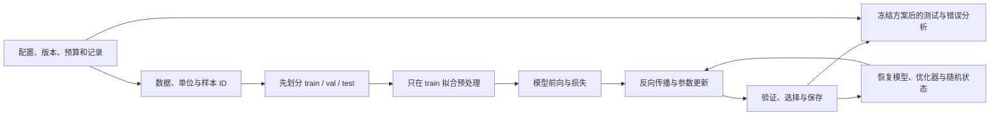

# 第七章怎么学：机器学习与深度学习

[本章概览](README.md) · [知识索引](知识索引.md) · [练习与复盘](练习与复盘记录.md) · [第三章](../03_机器人学基础/学习指南.md) · [第六章](../06_仿真与系统集成/学习指南.md) · [第一阶段](../阶段计划/第一阶段_学习范围与周计划.md) · [第二阶段](../阶段计划/第二阶段_学习范围与周计划.md)

版本：2026-10-30，第二版。10 节讲义、40 道自编练习与独立答案、5 幅参考图。已重新核对 CPU 基础、GPU 训练、跨进程恢复与资源测量。主线是独立组织一个小型监督实验，后面几节按机器人学习任务选读。

## 先把一个小实验讲清楚

这一章的核心能力：给定数据与目标，说明模型怎样接收输入、损失怎样产生梯度、参数怎样更新，以及怎样判断结果可信。



不要把“跑出了 loss”作为终点。能解释一次失败、从保存点恢复、换一组数据检查误差，才开始具备独立训练能力。

## 十节导航与深度

| 讲义 | 主问题 | 当前学习范围 | 答案 |
|---|---|---|---|
| [ML-01 Tensor、维度与设备](讲义/ML-01_Tensor维度与设备.md) | 每个维度表示什么 | 必须掌握 | [提示与答案](参考答案/ML-01_参考答案.md) |
| [ML-02 梯度、计算图与自动求导](讲义/ML-02_梯度计算图与自动求导.md) | 一个参数为什么这样更新 | 必须掌握 | [提示与答案](参考答案/ML-02_参考答案.md) |
| [ML-03 数据、训练、验证与恢复](讲义/ML-03_数据训练验证与恢复.md) | 怎样独立组织训练 | 必须掌握 | [提示与答案](参考答案/ML-03_参考答案.md) |
| [ML-04 MLP、卷积与视觉表征](讲义/ML-04_MLP卷积与视觉表征.md) | 网络结构与任务怎样匹配 | MLP 必做，CNN 做小例子 | [提示与答案](参考答案/ML-04_参考答案.md) |
| [ML-05 过拟合、泄漏与排错](讲义/ML-05_过拟合泄漏与排错.md) | 指标很好却失效，先查什么 | 必须掌握，和 ML-03 一起用 | [提示与答案](参考答案/ML-05_参考答案.md) |
| [ML-06 注意力、掩码与 Transformer](讲义/ML-06_注意力掩码与Transformer.md) | token 怎样交换信息 | 必须理解维度和机制；不训练大模型 | [提示与答案](参考答案/ML-06_参考答案.md) |
| [ML-07 自监督、预训练与多模态](讲义/ML-07_自监督预训练与多模态.md) | 表征怎样迁移到新任务 | 了解，选题时深入 | [提示与答案](参考答案/ML-07_参考答案.md) |
| [ML-08 概率生成、扩散与流匹配](讲义/ML-08_概率生成扩散与流匹配.md) | 多种合理输出怎样建模 | 了解；生成策略需要时深入 | [提示与答案](参考答案/ML-08_参考答案.md) |
| [ML-09 资源、混合精度与微调](讲义/ML-09_资源混合精度与微调.md) | 如何用有限显存做实验 | 先学预算与小批量；AMP/LoRA 选读 | [提示与答案](参考答案/ML-09_参考答案.md) |
| [ML-10 泛化、评测与实验记录](讲义/ML-10_泛化评测与实验记录.md) | 怎样比较方法并保留失败 | 必须掌握，贯穿主项目 | [提示与答案](参考答案/ML-10_参考答案.md) |

建议顺序：01 → 02 → 03；03/04/05/10 在同一个项目中往返。06 接序列模型；07/08/09 随研究问题补充。完成 01—05 的最低验收就可以开始第八章基础 BC、RL，不必先通读全部前沿论文。

## 主项目：学习一个已知的几何映射

复用第三章平面双关节：L1=0.3 m、L2=0.2 m，输入 `[q1,q2]`，输出 `[x,y]`：

$$
x=0.3\cos q_1+0.2\cos(q_1+q_2),\quad
y=0.3\sin q_1+0.2\sin(q_1+q_2).
$$

解析 FK 在这里提供准确标签和独立检查。网络只做函数近似；这项练习不构成策略学习或控制器，也不替代已知 FK。

| 数据 | 数量、局部随机种子 | q1 范围 / q2 范围，单位 rad | 用途 |
|---|---|---|---|
| train | 512 / 7 | [-1,1] / [-1.2,1.2] | 更新参数、拟合输入均值/尺度 |
| val | 128 / 8 | 同 train | 选超参数与 checkpoint |
| IID test | 256 / 9 | 同 train，独立采样 | 方案冻结后的同分布测试 |
| OOD test | 256 / 10 | [1.2,1.5] / [1.3,1.8] | 检查特定外推区域，不能代表全部 OOD |

两种模型：线性层 2→2（6 参数）；Tanh MLP 2→32→32→2（1218 参数）。参考比较固定 Adam、学习率 0.003、batch=64、200 epoch，每个模型 1600 次更新。输出用米，输入按训练集标准化，val/test 不重新拟合统计量。选模只看 val；训练曲线在每轮结束后以 eval 模式重新计算。

本机主路线用 CUDA FP32，CPU 提供完整替代。作者已在两后端分别跑三种子对照；数据与初始模型先在 CPU 生成，再按 device 搬运。初学先在一个后端完成完整训练，用同一份代码/配置切换设备；不要求为每个知识点重复搭两套项目。AMP 在 FP32 流程可解释之后再接入 ML-09。

你的项目自己完成：配置、数据生成与划分、训练入口、checkpoint、评测入口、图和报告。答案只提供局部函数与核对点。参考图和作者结果见[图示](图示/README.md)与[核对记录](示例核对记录.md)，不作为你的验收证据。

## 分三次留下可验收成果

| 成果 | 理论与代码 | 独立验收 |
|---|---|---|
| A：梯度与张量说明 | ML-01/02；手算一轮线性回归，再与 autograd、有限差分比对 | 指出 shape 错误；解释梯度累积和 detach；手算值吻合 |
| B：小型训练工程 | ML-03/04/05；先拟合 16 个点，再做主项目 | train/val 分开；模型/输入/grad 设备正确；恢复预测一致；能解释一项故意引入的错误 |
| C：可复查的比较报告 | ML-10；固定数据和预算，比线性/MLP，记录 IID/OOD | 报告单位、选模规则、所有运行、失败与适用范围 |

主线初次学习可占约 2—3 个个人学习周，已有能力可用验收抵扣；这是第三阶段的容量参考，不是新增的日期承诺。CNN、注意力、预训练、生成模型各做最小实验，后续按选题增加。

GPU 扩展分两次验收：ML-03 在新进程恢复 FP32 续训，核对模型/Adam/CPU-CUDA-loader RNG；ML-09 再加 scaler，测当前输入的时间与显存。作者重跑发现，小 CNN 上 AMP 比 CUDA FP32 慢；遗漏 scaler 时权重可相同但状态不同。用这些例子练习“结果证明了什么”，不以使用更多技术作为完成标准。

第一阶段只选 ML-01 的维度练习与 ML-02 的一个梯度验证，合计不超过约 2 小时，不加入结项要求。第二阶段前置已具备时，选 ML-03 的一次训练/保存小练习，约 3 小时内；完整主项目可留第三阶段。其他阶段任务照原周计划执行。

## 资料怎样用

主资源用 [PyTorch Learn the Basics](https://docs.pytorch.org/tutorials/beginner/basics/intro.html)，先看本节指定部分，合上网页自己改一个输入。理解卡住时查 [D2L 中文版](https://zh.d2l.ai/)，数学只补 [MML](https://mml-book.github.io/) 中当前用到的链式法则、概率和优化。每节列了选读范围，不需要把整本书读完。

论文记录四件事：输入输出、训练目标、推理流程、证据与局限。注意力/ViT/CLIP/扩散/流匹配先读问题、核心图与目标函数，暂不复现其完整训练。新方法出现时也可以按这四件事归类。

## 环境与资源边界

本次只读使用已有解释器 `/home/m/miniconda3/envs/ymbot/bin/python`：Python 3.12.13、PyTorch 2.6.0+cu124、NumPy 1.26.4；没有安装或修改该环境。系统 Python 与默认 Conda Python 没有 torch。自己的练习建议用个人隔离环境，先确认当前解释器与包版本：

```python
import sys
import torch
print(sys.executable, torch.__version__)
print("CUDA build:", torch.version.cuda, "available:", torch.cuda.is_available())
if torch.cuda.is_available():
    print(torch.cuda.get_device_name(0))
    print("total GiB:", torch.cuda.get_device_properties(0).total_memory / 2**30)
```

本机已实测 RTX 4060 Laptop，CUDA 可用，nvidia-smi 总显存为 8188 MiB。CPU 基础与 CUDA 主实验均已重跑；FK、CNN、注意力、FP32/AMP 新进程恢复与小模型资源短测的条件/原始数值见[核对记录](示例核对记录.md)。主要图示已更新为 CUDA 结果，划分泄漏仍用 NumPy/CPU。

“安装了 CUDA 构建”不等于每个执行环境都能访问 GPU：最初隔离运行时看不到设备，放开权限后才可直接使用。自己的终端仍先确认解释器、is_available、设备和一次前向/反向。CPU 足以完成主线；真机时间不影响本章进度。

学习用最小 batch 起步。主训练先 FP32，AMP 按相同输入测收益；显存峰值、速度、归一化和数据搬运范围都要记录。一次 TinyCNN 的资源结果不能替代你未来视觉/序列模型的测量，也不需要为了本章更改驱动或实验室依赖。

在线教程会更新；本次关键 API 对照 PyTorch 2.6 文档。其他安装版本应查对应文档。资源测量与 AMP 路径见 ML-09。

## 第一次约一小时与中断恢复

第一次只做：写出 `[B,2]→[B,2]` 的含义，手算 ML-02 第 1 题，运行一次梯度核对，再写三句话说明 loss、gradient、parameter 的关系。做到这里就有一份可核验成果。

中断前写：当前配置、最后一个已保存 epoch、已确认结果、一个未解决问题、下次第一步。短周保留一项验证即可；不靠补齐阅读页数追赶进度。每节最后的直觉提示用于自己的复盘，不要求照抄结论。

第八章会在此基础上学习观测/动作契约、模仿学习、RL、模型学习、规划与学习结合、迁移和多模态策略；本章提供通用训练工具。
