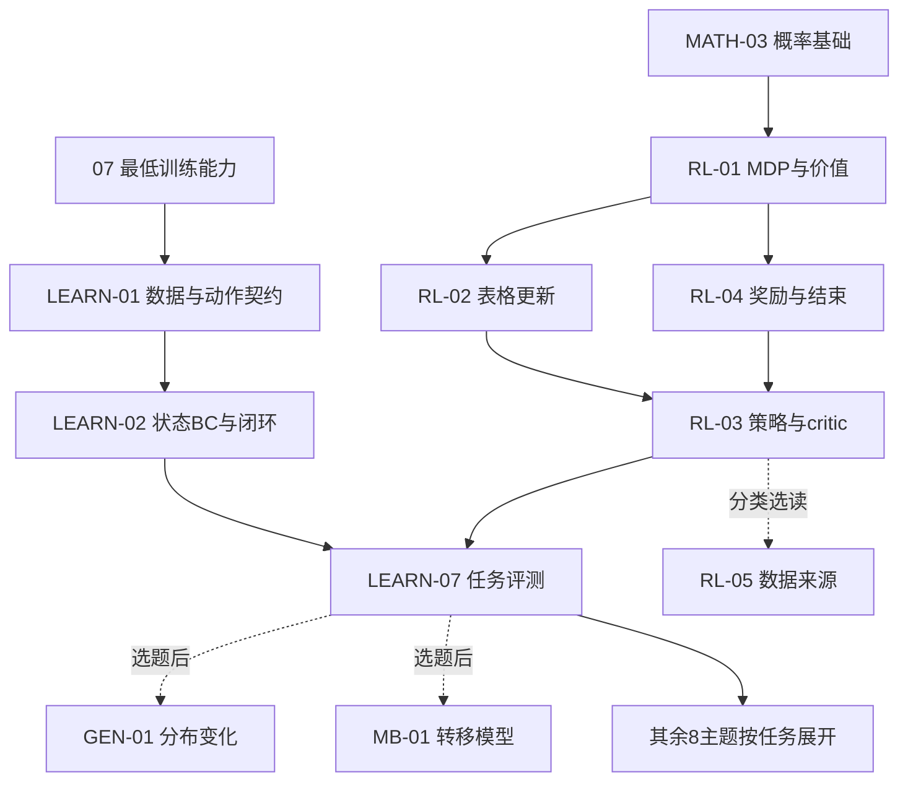

# 第八章怎么学：先建立两个学习闭环

[本章概览](README.md) · [知识索引](知识索引.md) · [分节导读](导读.md) · [练习与复盘](练习与复盘记录.md) · [内容维护约定](内容维护约定.md) · [第三阶段周计划](../阶段计划/第三阶段_学习范围与周计划.md)

基础版 v0.1 · 2026-11-07。现有10节基础讲义、40道自编练习与独立答案；18个主题的导读/编号全部保留。材料备好不表示已经学完，当前仍按第一阶段实际周次推进。

## 本章多问的一步

第七章主要研究“从固定输入预测得准不准”；本章再问“自己的输出改变了之后的观测，任务还能不能完成”。学习器可能输出动作、价值或状态预测，不必都变成大模型。

先完成状态BC和表格/标准环境RL两个基础闭环，再将其中一个问题深入。模型学习、泛化和更复杂策略按需要接入。

## 十节基础导航

| 讲义 | 先解决的问题 | 使用位置与深度 | 答案 |
|---|---|---|---|
| [LEARN-01 数据契约](讲义/LEARN-01_数据状态观测与动作契约.md) | 每个字段到底表示哪一步、哪个动作？ | W23主线；临时接数据时可提前查 | [答案](参考答案/LEARN-01_参考答案.md) |
| [LEARN-02 状态BC](讲义/LEARN-02_状态BC与闭环偏移.md) | 为什么动作loss低，滚动仍失败？ | W24主线 | [答案](参考答案/LEARN-02_参考答案.md) |
| [RL-01 MDP与价值](讲义/RL-01_MDP回报价值与Bellman.md) | 奖励怎样成为长期决策依据？ | W25主线 | [答案](参考答案/RL-01_参考答案.md) |
| [RL-02 表格Q-learning](讲义/RL-02_表格Q学习与探索.md) | 一条经验怎样改一个Q值？ | W25主线 | [答案](参考答案/RL-02_参考答案.md) |
| [RL-03 策略梯度与算法机制](讲义/RL-03_策略梯度ActorCritic与算法机制.md) | actor、critic、采样和更新怎样接起来？ | W26先理解；成熟实现当时校准 | [答案](参考答案/RL-03_参考答案.md) |
| [RL-04 奖励与结束](讲义/RL-04_奖励终止截断与任务评测.md) | 什么算成功，什么只是采样暂停？ | W25—W26配合使用 | [答案](参考答案/RL-04_参考答案.md) |
| [RL-05 数据来源与策略关系](讲义/RL-05_在线离线与OnOffPolicy.md) | 在线/离线与on/off-policy怎么区分？ | 选读，不新增算法训练 | [答案](参考答案/RL-05_参考答案.md) |
| [MB-01 模型学习](讲义/MB-01_转移模型多步误差与规划.md) | 预测状态和选择动作有什么关系？ | 选题需要时学；不列为新增主线 | [答案](参考答案/MB-01_参考答案.md) |
| [GEN-01 泛化与迁移证据](讲义/GEN-01_泛化分布变化与迁移证据.md) | 到底改了哪一种条件？ | W28后评测时查 | [答案](参考答案/GEN-01_参考答案.md) |
| [LEARN-07 评测与方法选择](讲义/LEARN-07_闭环评测复现与方法选择.md) | 结果足以支持什么结论？ | W23起贯穿，不独占一周 | [答案](参考答案/LEARN-07_参考答案.md) |

其余8个主题：LEARN-03/04、RL-06、MB-02、LEARN-05、VLA-01、LEARN-06/08。继续从[分节导读](导读.md)找问题，最低前置查知识索引。它们并非都容易过时，而是当前不需要同时展开。

## 怎样用练习，避免又变成任务堆

每讲有4题，通常从概念/手算走到局部实现和项目核对。先看目标和题目 → 按需读正文 → 自己尝试 → 卡住查指定资料 → 最后核对答案并写复盘。

练习是工具箱，不是新增40题打卡。已有解释/实现/结果可以抵扣；同一份P3成果可同时覆盖多题。项目题沿用原周预算，不能给每题再加一个完整项目周。

W25可合并为RL-01的一张MDP卡、RL-02的一次更新与表格程序、RL-04的一张结束语义表；不要求一周完成三讲全部题目。RL-05/MB-01及额外泛化实验按选题选用。

## 两个小成果复用原计划

| 成果 | 最低实践 | 本章支持 | 没有真实机器人时 |
|---|---|---|---|
| P3-BC | 已验证教师→episode数据→状态MLP→独立滚动→教师/零动作对照 | LEARN-01/02/07 | 原P1平面双关节运动学后端 |
| P3-RL | 手算/Q-learning→成熟PPO小任务→重载与独立评测 | RL-01/02/03/04，分类按需查RL-05 | Python小MDP/FrozenLake，后用CartPole |
| P3-main | 一个窄问题、一个对照、重复与失败分析 | LEARN-07；GEN-01或MB-01等按题补 | 在已可运行后端完成，迁移另设条件 |

阈值、数据量、周次与预算以[第三阶段规格](../阶段计划/第三阶段_学习范围与周计划.md#bc-task)为准。讲义中的一维/小网格例子用于手算，不替换项目任务，也不算机器人硬件成果。

## 工具到使用前再定

基础手算和局部函数可用Python/NumPy；小MLP复用第七章已验证的训练知识。未来需要新库时使用项目隔离环境，先确认解释器；普通学习环境、ROS环境和实验室运行环境分别管理。

2027年3月底先校准状态BC与表格RL的两个实现入口，W26前补成熟PPO入口。日期、资料版本、实际运行范围与修改触发写进[实现专题](实现专题/README.md)，不提前填写“已运行”。

## 导师怎样帮助

你先给当前目标、自己的解释、最小代码/现象和预期结果。协作顺序是提示一个检查点 → 追踪数据 → 看局部实现 → 核对实验。答案提供公式、局部数值与验收点；完整训练/环境/评测循环由你建立。

一次中断只需留：当前文件/配置、已验证到哪、下一次最小动作。复习按这个缺口回来，不重新通读整章。
