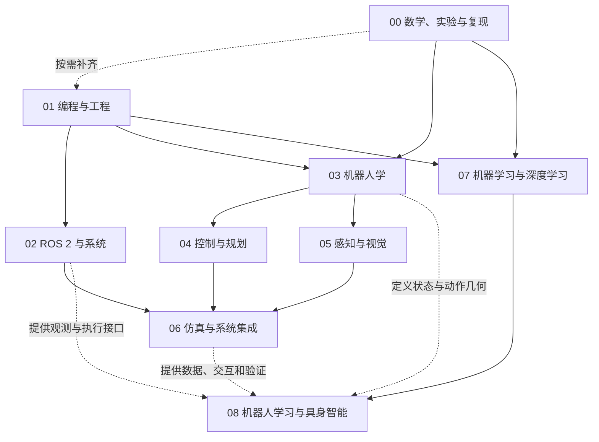
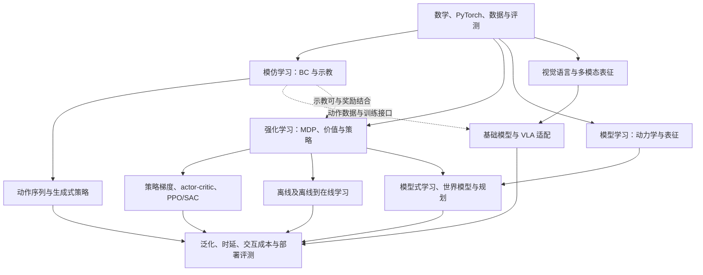

# 总知识网络：概念、依赖与学习顺序

[返回总入口](README.md) · [公共学习方法](00_公共基础与学习方法/README.md) · [机器人学习全景](08_机器人学习与具身智能/README.md)

公共配套已展开：[第零章学习指南](00_公共基础与学习方法/学习指南.md)。数学和实验方法随当前项目查阅，已有证据可抵扣，不增加进入第一阶段的先修门槛。

版本：2026-11-02。本文件描述稳定知识结构和阶段成果，具体技术与月/周任务随进展更新。

第一阶段已细化为[学习范围与 13 周计划](阶段计划/第一阶段_学习范围与周计划.md)，配套[进度记录](阶段计划/第一阶段_进度记录.md)。该计划明确了各方向本期只学哪些部分，日常按当前周推进。

第二阶段已细化为[学习范围与 W14—W21 周计划](阶段计划/第二阶段_学习范围与周计划.md)，配套[进度记录](阶段计划/第二阶段_进度记录.md)。重点是标定、空间定位、运动规划与视觉引导到达，保留缓冲和无真机路径。

第三阶段已有[暂定 v0.1 周计划](阶段计划/第三阶段_学习范围与周计划.md)，配套[进度与修改记录](阶段计划/第三阶段_进度记录.md)。2027年4—6月覆盖W22—W33：BC/RL各一项入门实践，然后一个深化问题；W27/W31为可移动缓冲。2027年3月底及选题检查点按证据修订。

2026-11-07补充：[第八章基础学习指南](08_机器人学习与具身智能/学习指南.md)已展开数据契约、BC、RL核心机制、模型学习与评测等10个主题。稳定编号/基础、版本化实现、资料指针按[维护约定](08_机器人学习与具身智能/内容维护约定.md)分别更新；其余主题保留导读，不预先锁定未来技术。

## 八个方向怎样衔接



实线表示主要知识依赖，虚线表示系统支撑。各方向包含不同深度的内容，图中的依赖不要求先学完整门课程。轻量仿真从第一阶段开始；监督学习和 RL 小环境可以在机器人系统尚未全部完成时独立学习。

## 关键概念的归属与边界

| 概念 | 主要学习位置 | 在其他方向怎样使用 |
|---|---|---|
| 坐标与刚体变换 | 03 | 02 用 TF2 管理；05 做标定/定位；08 定义动作 |
| 时间与状态/命令 | 02 | 04 理解控制周期；06 对齐仿真；08 对齐数据与策略执行 |
| 机器人模型 | 03 学数学，02 学描述与接口 | 04 求解与控制；06 做规划/物理验证 |
| 控制和规划方法 | 04 | 06 使用 MoveIt/MuJoCo 集成；08 与学习策略组合 |
| 感知模型与标定 | 05 | 06 形成任务输入；08 使用观测并评测误差影响 |
| 网络与训练机制 | 07 | 05 使用视觉模型；08 学策略、价值、动力学和多模态 |
| 数据、评测与复现 | 00 规定基本方法 | 全部方向都保留输入、配置、指标、失败与证据 |

## 从观测到动作的运行链路

```text
相机/关节/力等观测
        ↓ 时间对齐、坐标、单位、预处理
任务目标或学习策略
        ↓ 选择具体接口：规划轨迹 / 关节目标 / 末端增量 / 其他允许的动作
规划、IK、约束检查和必要转换
        ↓
控制器与硬件/仿真接口
        ↓
机器人或仿真执行
        ↓
反馈、日志与评测 → 下一次观测
```

不同系统可以合并或省略部分模块；以实际接口为准。每次接入一个方法，都要说清输入输出、动作定义和执行位置。策略频率、动作块长度、轨迹时间、控制周期和实际运动结果分别检查。源码推断、离线验证、仿真表现和真机表现分别记录。

## 机器人学习的多条路线



这些是可组合的方法关系。Transformer、扩散和流匹配描述表示/生成机制；模仿学习与强化学习描述学习信号和优化方式；世界模型描述对环境的建模。VLA 使用多模态信息与动作接口，可以与其他学习方式结合。

通用训练基础见[第七章学习指南](07_机器学习与深度学习/学习指南.md)：ML-01—05 与 ML-10 支持基础 BC、RL 和模型学习；ML-06 支持序列模型，ML-07/08 按表征或生成策略选学。开始基础 RL 不需要先训练 Transformer 或多模态模型。

| 维度 | 判断一个新方法时先问 |
|---|---|
| 学习信号 | 主要来自示教、交互奖励、自监督预测，还是它们的组合？ |
| 系统作用 | 它输出动作、价值、动力学、子目标、计划，还是表征？ |
| 前置与成本 | 需要什么观测、动作接口、数据量、交互次数和计算资源？ |
| 证据 | 比较基线是什么？评测覆盖什么任务和分布？结论有哪些限制？ |

## 2026.11—2027.06 的阶段顺序

| 阶段 | 重心与并行内容 | 可验收项目版本 | 不依赖真机的路径 |
|---|---|---|---|
| 2026.11—2027.01 | 工程、ROS 2、运动学、基础控制；轻量仿真与少量 PyTorch 穿插 | P1：机械臂运动与数据记录实验台 | NumPy、合成消息、mock hardware、MuJoCo |
| 2027.02—2027.03 | 相机/手眼标定、空间定位、碰撞规划与系统集成 | P2：视觉引导的机械臂操作 | 公开/合成标定数据、虚拟相机、标准机械臂仿真 |
| 2027.04—2027.06 | BC 和 RL 基础各有小闭环；选一条学习路线深入，探索其他分支 | P3：机器人学习训练与评测系统 | 匹配任务的示教与仿真；标准 RL 环境 |
| 本科毕业后至研一 | 项目整理与实习；围绕一个问题选择研究支线 | 在可复现基线上进行方法对照与研究扩展 | 保持仿真与公开数据基线，真机作增量验证 |

P3初稿暂定状态BC的数据覆盖对照，W27可改为RL深化；ACT/扩散策略、模型学习、VLA等按数据、评测后端和算力选择。具体见[分支选择](阶段计划/第三阶段_学习范围与周计划.md#branches)。先完成BC与一个成熟RL实现的基础，再依据问题决定扩展，不同时复现全部候选。

## 阶段验收与跨阶段条件

| 版本 | 最少保留的证据 | 进入下一阶段前检查 |
|---|---|---|
| P1 | FK/雅可比交叉验证；可达/不可达案例；指令与状态记录；跟踪误差曲线；数据流图 | 能解释坐标、单位、关节顺序、时间和执行接口 |
| P2 | 标定参数与独立验证；目标定位；到达/抓放记录；障碍与异常处理；失败拆解 | 任务能复位、成功可判定、数据与动作可对齐 |
| P3 | 数据/环境版本；训练与恢复；基线；固定评测；成功数/总数、开销与失败；一个消融 | 能独立说明方法选择、实现修改、实验结论与局限 |

上述模块尽量汇入一个持续演进的项目。标准 RL 小环境可以单独作为入门实验，保留与机械臂主项目不同的环境假设。CPU/小 GPU 先完成小规模闭环，扩大训练量前测时间与显存。

离线误差与闭环成功率分开报告；仿真与真机结果分开报告；评测次数和训练种子明确记录。未达到任务效果时，保留可解释的失败与改进证据。

## 研一的开放方向

- 学习与数据：数据质量、示教覆盖、离线到在线学习、奖励与反馈。
- 表示与模型：动作表示、序列策略、动力学/世界模型、多模态表征。
- 系统与泛化：时延鲁棒性、sim-to-real、模型与控制结合、未见任务/物体。
- 操作任务：双臂协调、接触丰富操作、灵巧手与触觉；按设备与课题选择。

每次选择一个可测量的问题。已有系统与经典方法继续作基线，新技术先做最小验证，再决定是否成为主线。具体更新方式见[方向 08](08_机器人学习与具身智能/README.md)。

## 使用这张网络安排学习

按阶段选择主成果 → 从索引查最低前置 → 理论与代码配对 → 用明确指标验收 → 保存证据并更新下一步。每四周根据个人时间、实验室插单和资源重新估计范围，保留中断恢复记录。

